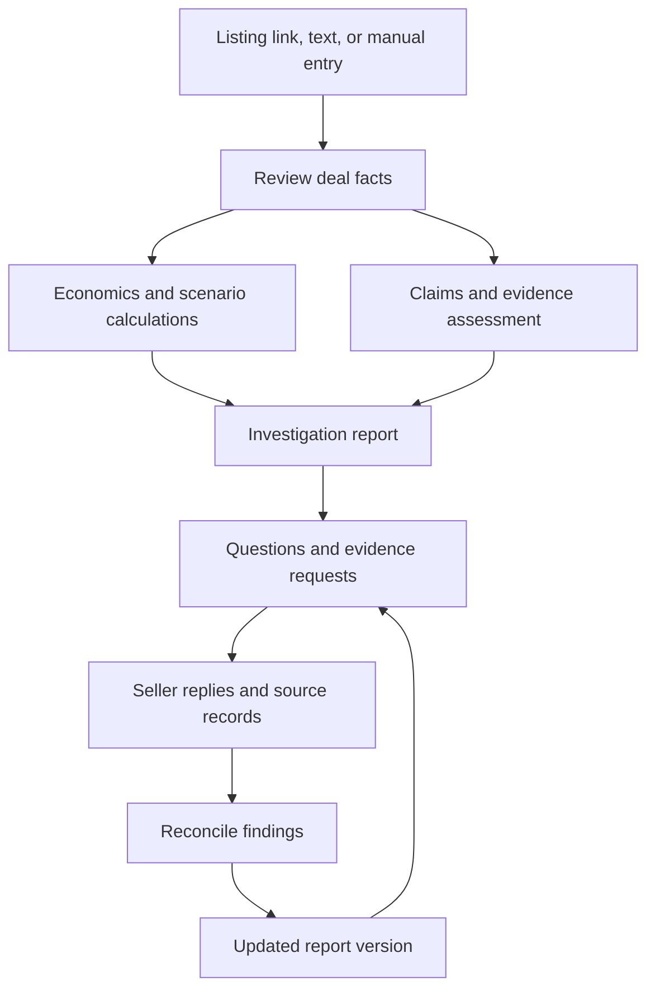

# Deal Preflight

### Understand the deal before you buy the business.

Deal Preflight is a web product for investigating small online-business acquisitions. It helps buyers examine the economics, track the support for seller claims, and turn unresolved risks into practical follow-up work.

[Live product](https://dealpreflight.com) · [How it works](https://dealpreflight.com/how-it-works)

> **Product and engineering showcase.** The production source code is private. This repository documents the public product workflow and selected engineering concerns.

## The problem

A listing is the start of an acquisition investigation. Buyers need to understand how the numbers were derived, which statements have supporting records, and what must transfer for the business to keep operating.

Deal Preflight organizes that work into a deal workspace that can evolve as evidence and seller responses arrive.

## Product workflow

| Stage | Buyer experience |
| --- | --- |
| Screen | Import a public listing, paste text, or enter facts; review extracted inputs before analysis. |
| Investigate | Examine multiples, payback, downside cases, risk findings, and targeted seller questions. |
| Reconcile | Compare supplied records with saved claims and attach seller replies to findings. |
| Update | Revise the deal and preserve successive report versions as the investigation develops. |

## Engineering focus

The public product demonstrates several connected responsibilities:

- Structured intake and confirmation of listing information.
- Deterministic calculations from confirmed inputs.
- Separate treatment of seller assertions, observed evidence, and unresolved questions.
- A persistent investigation record linking findings, replies, and evidence assessments.
- Versioned reports that retain earlier states of the deal.

### Functional overview

This is a product workflow diagram, rather than a deployment or infrastructure map.

## Builder

Built by [Paluk Gupta](https://github.com/paluuuk).

## Repository scope

This is a documentation-only showcase. Production source code, proprietary prompts, infrastructure configuration, credentials, and private customer or seller records remain private. There is no runnable application or open-source implementation in this repository.

